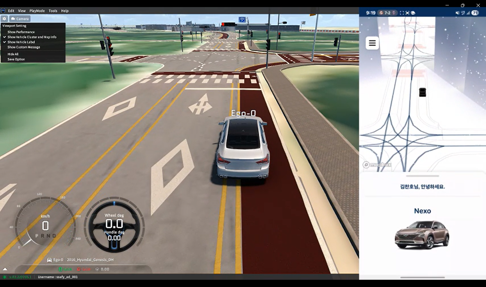
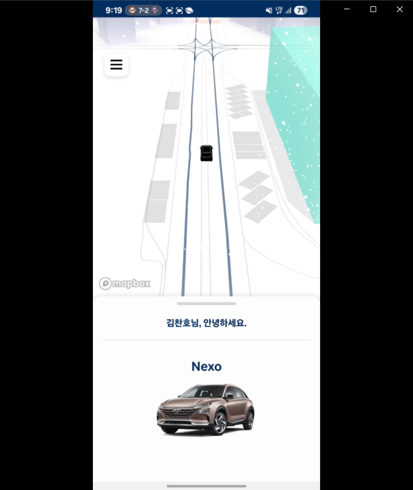
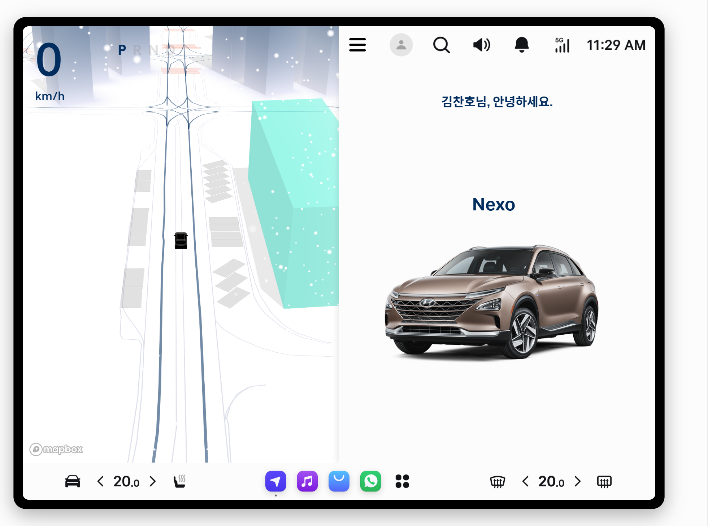
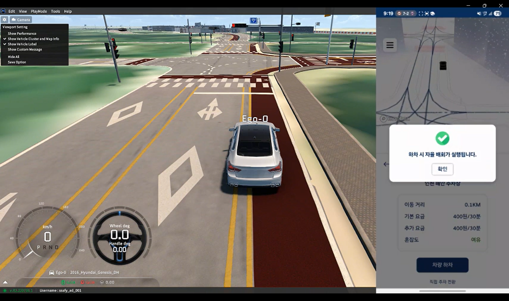
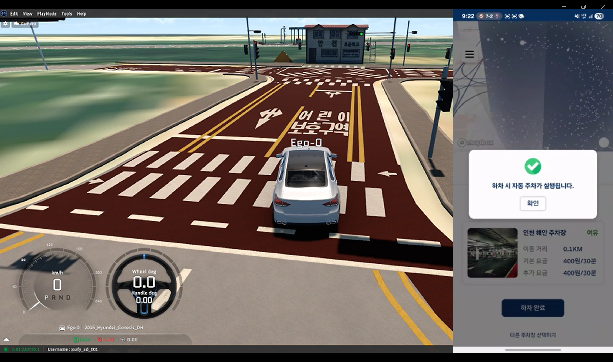
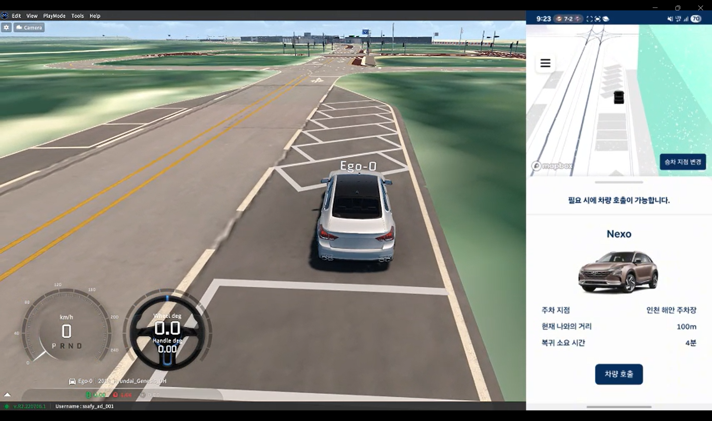
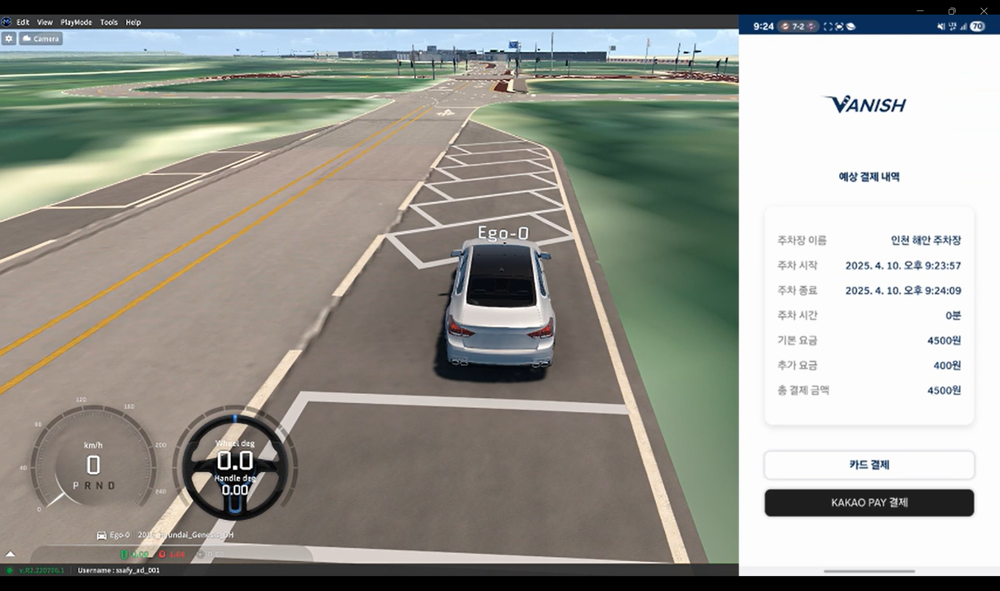
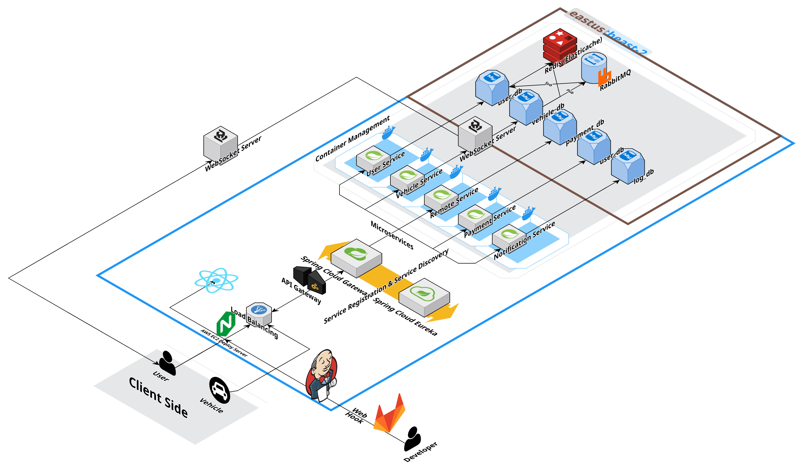

# Vanish: 자율주행 기반 자동 주차 및 호출 시스템

<p align="center">
  
</p>

SSAFY 특화 프로젝트 : 자율주행 기반 자동 주차 및 호출 서비스

개발 기간 : 2025/02/24 ~ 2025/04/11

## 프로젝트 소개

**Vanish**는 차량 사용자가 하차한 이후, 차량이 스스로 인근 주차 공간을 탐색하여 주차하고, 필요 시 모바일 앱을 통해 호출하면 현재 위치로 자동 복귀하는 **자율주행 기반의 스마트 주차/호출 서비스**입니다.

기존 차량 호출 기능의 한계를 넘어, 실시간 경로 계획, 주차장 결제, 사용자 인터페이스까지 통합적으로 구현하였습니다.

### 배포 주소

- **Frontend 서버**:
- **Backend 서버**: `https://j12a707.p.ssafy.io`  
- **시뮬레이션/ROS 노드 통신용 서버**: `Morai Simulator`


### 팀 소개

| 이름   | 역할            | GitHub 링크 | 주요 담당 기능 |
| ------ | --------------- | ----------- | --------------- |
| 김찬호 | ROS/FE | [@nonamed19](https://github.com/nonamed19) | 차선 인식, 라이다-카메라 센서 융합 |
| 김태민 | CI/CD     |  | 결제/호출 API, Jenkins 배포 자동화 |
| 문예찬 | ROS        |  | ACC, Global Path Planning, PID 제어 |
| 이석현 | BE   |  |  회원 관리, 차량 관리, 원격제어 서비스 |
| 이예진 | FE     |  | 인포테인먼트, 웹앱 기반 모바일 어플리케이션 |
| 홍정주 | ROS     |  | Pure Pursuit, Lattice Planner, 차선 변경 및 회피 |

---

## 시작 가이드

### Requirements

```
- ROS Melodic + Ubuntu 18.04
- Python 3.6+
- Spring Boot 3.4.1
- MySQL 8
- Redis
- Firebase Realtime DB
- RabbitMQ
- Docker + Jenkins
```

### Installation

#### Backend

```bash
$ cd backend
$ ./gradlew build
$ docker-compose up
```

#### Frontend

```bash
$ cd frontend
$ npm install
$ npm run dev
```

#### ROS

```bash
$ cd ~/catkin_ws
$ catkin_make
$ source devel/setup.bash
$ roslaunch vanish point_driving.launch
```

## 기술 스택

### Frontend

- **React 18.2.0:** 최신 리액트 버전을 사용하여 UI 구성 및 상태관리를 수행합니다.
- **Three.js:** 3D 렌더링을 위한 라이브러리로, 인터랙티브한 3D 콘텐츠를 구현합니다.
- **JavaScript & HTML5:** 기본 웹 기술을 활용하여 사용자 인터페이스를 구축하며, 반응형 디자인 구현 및 웹 표준 준수.
- **Firebase Cloud Messaging (FCM):** 푸시 알림을 통해 사용자와 실시간 소통을 가능하게 합니다.

### Backend

- **Spring Boot 3.4.1:** 현대적인 백엔드 애플리케이션 프레임워크로, 빠른 개발 및 배포를 지원합니다.
- **Liberica Standard JDK 17.0.13+12 (x86 64 for Linux):** 최신 JDK 버전을 통해 안정적인 자바 기반 애플리케이션 실행 환경 제공.
- **Gradle:** 효율적인 빌드 및 의존성 관리를 위한 도구.
- **RabbitMQ:** 메시지 브로커로, 각 서비스간의 비동기 통신과 이벤트 기반 처리를 담당.
- **Spring Cloud Gateway:** API 게이트웨이 역할을 수행하며, 클라이언트 요청을 각 서비스로 라우팅.
- **Netflix Eureka:** 서비스 등록 및 검색을 담당하여 MSA 환경에서 서비스 디스커버리를 지원.
- **Spring Security & JWT:** 보안 인증 및 인가 처리를 위한 프레임워크와 토큰 기반 인증 방식 도입.
- **Feign Client:** 서비스 간의 간편한 REST API 호출을 위한 선언형 HTTP 클라이언트.
- **Spring Email:** 이메일 발송 기능을 통한 사용자 알림 및 비밀번호 복구 등의 시나리오 대응.
- **WebSocket:** 실시간 양방향 통신을 지원하여, 빠른 데이터 전송 및 이벤트 기반 처리 구현.

### Database

- **MySQL 8.0.40:** 관계형 데이터베이스 시스템으로, 안정적인 데이터 저장 및 관리.
- **Redis:** 인메모리 데이터베이스로 캐싱과 Pub/Sub 기능을 통해 빠른 데이터 처리 및 서비스 반응성 강화.
- **JPA/Hibernate:** ORM 프레임워크를 사용하여 객체와 관계형 데이터베이스 간의 매핑 및 관리.

### Infrastructure

- **AWS EC2:** 확장성과 유연성이 있는 클라우드 인프라로 서버를 운영.
- **Ubuntu 24.04 LTS:** 안정적인 운영 체제로, 서버 환경에 최적화되어 있음.
- **Docker:** 컨테이너 기반 배포를 통해 독립적이며 일관된 실행 환경 보장.
- **Nginx:** 웹 서버 및 리버스 프록시로, 정적 파일 서빙 및 부하 분산 역할 수행.
- **GitLab:** 소스 코드 관리 및 협업 플랫폼으로, GitOps 방식의 버전 관리 체계를 지원.
- **Jenkins:** CI/CD 도구로, 자동화된 빌드, 테스트, 배포 파이프라인을 구성하여 지속적인 통합 및 배포를 가능하게 함.

## 화면 구성

|                                  모바일 어플리케이션                                  |                               인포테인먼트                               |
| :--------------------------------------------------------------------------------: | :--------------------------------------------------------------------------: |
|  |  |
|                                  차량 자율 배회                                  |                               차량 자동 주차                               |
|     |  |
|                                  차량 호출 기능                                  |                               자동 결제 기능                               |
|     |  |

### ROS 구성 노드

- `gps_parser.py`, `gpsimu_parser.py`: GPS/IMU 기반 위치 추정 및 오도메트리 생성
- `global_path_pub.py`, `local_path_pub.py`: 정밀도로 기반 전역/지역 경로 발행
- `pure_pursuit.py`, `pid_control.py`: 조향 및 속도 제어 알고리즘 구현
- `lattice_planner.py`: 장애물 회피를 위한 Lattice 기반 경로 생성 및 선택
- `camera_pedes_detector.py`: 카메라 영상 기반 보행자 인식
- `lidar_velodyne_cluster.py`: 라이다 포인트 클라우드 기반 객체 탐지 및 클러스터링
- `AdaptiveCruiseControl.py`: 전방 차량과의 거리 기반 ACC 속도 제어
- `parking_executor.py`: 목적지 도달 후 자동 주차 기능 실행
- `remote_action_client.py`, `remote_action_server.py`: 운전자 호출 요청에 따라 차량 자율 복귀 수행

## FE/BE 주요 기능

### 1. 회원 관리 서비스
회원 인증 및 로그인, 회원가입 및 계정 관리, 프로필 조회 및 업데이트, 회원 탈퇴

### 2. 차량 관리 서비스
차량 등록 및 정보 조회, 실시간 차량 위치 및 상태 정보, 주차 상태 변경

### 3. 원격제어 서비스
원격 명령 처리, 사용자 인증 및 권한 검증, 비동기 메시지 처리

### 4. 결제 서비스
결제 내역 관리 및 처리, 외부 결제 시스템 연동, 메시지 기반 이벤트 처리

### 5. 알림 서비스
FCM 토큰 관리, 푸시 알림 전송, 내부 로깅 및 모니터링

## ROS 주요 기능

### 1. 위치 인식 (GPS, IMU)
- Localization (좌표변환 WGS84 → UTM)
- Odometry 생성

### 2. 경로 생성
- 전역 경로 탐색 (A\*, Dijkstra 등)
- MGeo 데이터를 기반으로 경로 생성
- 사용자 지정 경로 파일(`.txt`)을 통한 경로 시각화 및 추출

### 3. 경로 계획
- 전역 경로 및 지역 경로를 기반으로 목표 지점까지 자율주행
- 실시간 차량 위치 및 장애물 데이터를 반영한 로컬 경로 갱신
- 상황 인지에 따른 동적 경로 변경 (차선 변경, 회피, 주차 진입 등)

### 4. 판단 / 제어
- Pure Pursuit: 전방 목표점을 추적하여 조향을 제어하는 알고리즘
- PID 제어: 목표 속도와 실제 속도 오차 기반의 속도 제어
- 속도 계획: 커브나 정지선 등 상황에 따른 속도 설정
- ACC: 앞차와의 거리 유지 기반의 자율 속도 조절

### 5. GT 기반 판단/제어
- 차선 변경 (GT 기반)
- 충돌 회피 (Lattice Planner)

### 6. 인지
- 카메라 센서를 통한 차선 인식
- 카메라 + 라이다 센서 퓨전
- 라이다 Point Cloud Clustering

### 7. 인지 + 판단/제어 통합
- 라이다 기반 차선 변경
- 라이다 기반 충돌 회피 (Lattice Planner)

### 8. 주차 및 호출 기능
- 목적지 도달 후 주변 주차장 탐색 및 주차 경로 생성
- 운전자 호출 시 Action 기반으로 자동 경로 계획 및 자율주행 수행

## 시스템 아키텍처



## MORAI Simulator 주행


## RViz 시각화 예시


## 개발 환경

- OS: Ubuntu 18.04
- ROS: Melodic
- Simulation: MORAI Simulator (v.R2.220706.1)
- 개발 도구: VMware / VSCode / Git / Notion

## 향후 과제 및 개선점

- 실제 차량 연동 테스트 및 오류 대응 시스템 구축
- 스마트 주차장 API 연동 (실시간 빈자리 정보 수집)
- 배회 알고리즘 연료 효율 최적화
- 도심 내 환경에 맞는 HD 맵 업데이트 자동화
- 인포테인먼트 UI 개선 및 다크모드 적용
